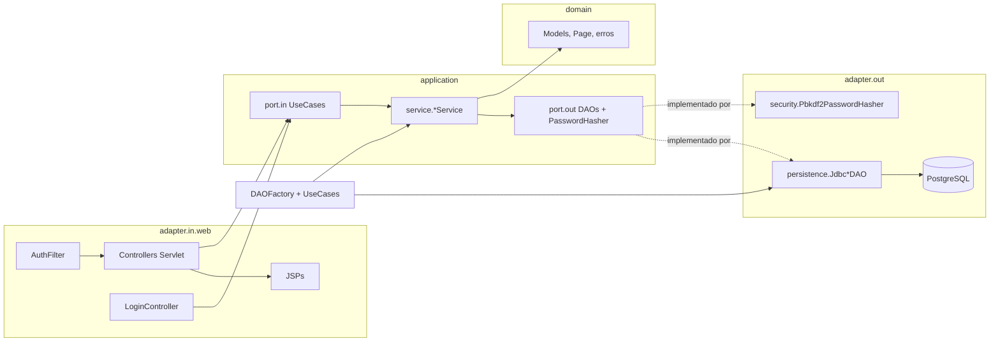
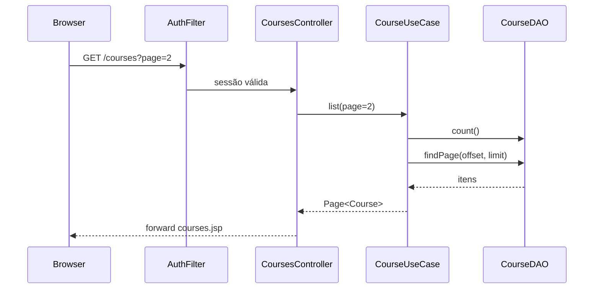

# Plataforma de Cursos Design

**Spec**: `.specs/features/plataforma-cursos/spec.md`
**Status**: Approved

---

## Architecture Overview

Abordagem escolhida (a recomendada): hexagonal completa, com os cinco cadastros e o login passando por portas de entrada (casos de uso) e portas de saída (DAOs). As alternativas descartadas: manter o `DAOFactory` chamado direto pelos Servlets (não isola regras) e uma camada de serviço sem portas de entrada (os Servlets dependeriam de classes concretas).





Regras de negócio (validação de campos, unicidade aluno-curso, concluída exige 100%, clamp de página, ordem, verificação de senha) vivem em `application.service`. Os Servlets traduzem HTTP para chamadas e erros para mensagens. As JSPs só exibem.

---

## Code Reuse Analysis

### Existing Components to Leverage

| Component | Location | How to Use |
| --------- | -------- | ---------- |
| `DBHandler` | `src/main/java/model/dao/DBHandler.java` | Mover para `adapter.out.persistence.jdbc`; acrescentar `setBoolean`, `setDecimal`, `setLong`, `getBoolean`, `getDecimal`, `setNull` |
| Modelos POJO (`User`, `Post`, `Company`) | `src/main/java/model/` | Mover para `domain.model`; datas viram `LocalDate`; `User` ganha `passwordHash` |
| `ControllerUtil` | `src/main/java/controller/ControllerUtil.java` | Mover para `adapter.in.web.WebUtil`; mantém mensagens por sessão (flash) e ganha parse de `page` |
| `CharacterEncodingFilter` | `src/main/java/controller/` | Mover; ordem definida no `web.xml` antes do `AuthFilter` |
| JSPs (`companies.jsp`, `form-company.jsp`, `modal.html`) | `src/main/webapp/` | Padrão de lista, formulário com select e modal de exclusão replicado para Cursos e Matrículas |
| Bootstrap 3 + jQuery em `webapp/css`, `js` | `src/main/webapp/` | Sem mudança |

### Integration Points

| System | Integration Method |
| ------ | ------------------ |
| PostgreSQL | `JdbcConnectionFactory` lê `DB_URL`, `DB_USER`, `DB_PASSWORD` do ambiente; falta de variável é erro explícito |
| Tomcat | WAR `crud-manager.war`; `web.xml` ordena filtros e define `error-page` 500 |
| Docker Compose | `db` (postgres:16, volume nomeado, `script-sql.sql` em `/docker-entrypoint-initdb.d`) e `app` (tomcat:10.1-jdk21) |

---

## Components

### Domain (`crudmanager.domain`)

- **Purpose**: Modelos e erros de negócio, sem dependência de framework.
- **Location**: `src/main/java/crudmanager/domain/{model,error}/`, `Page.java`
- **Interfaces**:
  - `Page<T>`: `items`, `page`, `pageSize`, `totalItems`, `totalPages()`, `hasPrevious()`, `hasNext()`; `static <T> Page<T> of(...)`
  - Erros: `ValidationException(Map<String,String>)`, `NotFoundException`, `DuplicateException`, `RelatedDataException`, `ModelException` (falha de dados)
  - Modelos: `User`, `Post`, `Company`, `Course` (`Level`), `Enrollment` (`Status`)
- **Dependencies**: JDK (`java.time`, `java.math`).

### Ports (`crudmanager.application.port`)

- **Purpose**: Contratos de entrada e saída.
- **Location**: `port/in/*UseCase.java`, `port/out/*DAO.java`, `port/out/PasswordHasher.java`
- **Interfaces**:
  - Entrada por cadastro: `Page<X> list(int page)`, `X find(int id)`, `void create(X)`, `void update(X)`, `void delete(int id)`; `UserUseCase` aceita senha em texto no `create`/`update` como parâmetro; `AuthUseCase.login(String email, String password): Optional<User>`
  - Saída por cadastro: `boolean save(X)`, `boolean update(X)`, `boolean delete(X)`, `X findById(int)`, `List<X> listAll()` (para selects), `List<X> findPage(int offset, int limit)`, `long count()`; `UserDAO.findByEmail`, `UserDAO.updatePasswordHash`; `EnrollmentDAO.existsByStudentAndCourse(int, int, Integer ignoreId)`
  - `PasswordHasher`: `String hash(String raw)`, `boolean matches(String raw, String stored)`
- **Dependencies**: domain.

### Services (`crudmanager.application.service`)

- **Purpose**: Regras. `PAGE_SIZE = 10` num único ponto (`Pagination`).
- **Interfaces**: `UserService`, `PostService`, `CompanyService`, `CourseService`, `EnrollmentService`, `AuthService` implementam as portas de entrada.
- **Dependencies**: portas de saída. Nenhum import de `jakarta.servlet`, `java.sql`.
- **Reuses**: lógica de mensagens dos controllers atuais.

### Persistence adapter (`crudmanager.adapter.out.persistence`)

- **Purpose**: JDBC PostgreSQL.
- **Interfaces**: `Jdbc{User,Post,Company,Course,Enrollment}DAO`, `JdbcConnectionFactory`, `DBHandler`, `DAOFactory` (`createDAO(Class)`).
- **Notes**: paginação com `ORDER BY id LIMIT ? OFFSET ?`; listagens de matrícula e curso usam JOIN para trazer nome do aluno, título do curso e nome do instrutor; violação de FK (`SQLState 23503`) vira `RelatedDataException`, violação de unique (`23505`) vira `DuplicateException`.
- **Reuses**: `DBHandler`, SQL dos DAOs MySQL atuais, traduzido (`CURDATE()` → `CURRENT_DATE`, `ENUM` → `CHECK`).

### Security adapter (`crudmanager.adapter.out.security`)

- **Purpose**: `Pbkdf2PasswordHasher` (PBKDF2WithHmacSHA256, 210000 iterações, salt de 16 bytes, formato `iterações:saltB64:hashB64`, comparação em tempo constante).

### Web adapter (`crudmanager.adapter.in.web`)

- **Purpose**: HTTP.
- **Interfaces**: `AuthFilter` (`/*`; libera `/login`, `/css/`, `/js/`, `/fonts/`, `/images/`), `LoginController` (`GET/POST /login`, `GET /logout`), `UsersController`, `PostsController`, `CompaniesController`, `CoursesController` (`/courses`, `/course/{form,insert,update,delete}`), `EnrollmentsController` (`/enrollments`, `/enrollment/...`), `WebUtil`, `UseCases` (composition root que monta serviços com o `DAOFactory`).
- **Notes**: rota por `req.getServletPath()` em vez do caminho `/crud-manager/...` fixo no código; `page` vem de `?page=` na listagem e de campo oculto no modal de exclusão; `req.changeSessionId()` no login; erros inesperados vão para `error.jsp` via `web.xml`.
- **Views**: `login.jsp`, `courses.jsp`, `form-course.jsp`, `enrollments.jsp`, `form-enrollment.jsp`, `pagination.jsp` (incluído nas cinco listagens), `nav-menu.jsp`, `error.jsp`.

---

## Data Models

```sql
-- users: id SERIAL PK, nome, sexo CHECK IN ('M','F'), email UNIQUE, password_hash TEXT NOT NULL
-- posts: id, content, post_date, user_id FK
-- companies: id, name, role, start, "end", user_id FK
CREATE TABLE courses (
  id SERIAL PRIMARY KEY, title VARCHAR(150) NOT NULL, description TEXT NOT NULL,
  price NUMERIC(10,2) NOT NULL CHECK (price >= 0), start_date DATE NOT NULL,
  level VARCHAR(15) NOT NULL CHECK (level IN ('INICIANTE','INTERMEDIARIO','AVANCADO')),
  active BOOLEAN NOT NULL DEFAULT TRUE,
  instructor_id INT NOT NULL REFERENCES users(id));
CREATE TABLE enrollments (
  id SERIAL PRIMARY KEY, student_id INT NOT NULL REFERENCES users(id),
  course_id INT NOT NULL REFERENCES courses(id), enrolled_on DATE NOT NULL,
  status VARCHAR(10) NOT NULL CHECK (status IN ('ATIVA','CONCLUIDA','CANCELADA')),
  progress INT NOT NULL CHECK (progress BETWEEN 0 AND 100),
  paid BOOLEAN NOT NULL DEFAULT FALSE, UNIQUE (student_id, course_id));
```

**Relationships**: `courses.instructor_id → users`; `enrollments.student_id → users`; `enrollments.course_id → courses`.

---

## Error Handling Strategy

| Error Scenario | Handling | User Impact |
| -------------- | -------- | ----------- |
| Validação falha | `ValidationException` com mapa campo→mensagem; controller reexibe o formulário com valores digitados | Mensagem por campo |
| Registro inexistente / id não numérico | `NotFoundException`; redirect para a lista | "Curso não encontrado." |
| FK impede exclusão | `RelatedDataException` | "… Há dados relacionados …" |
| Par aluno-curso repetido | `DuplicateException` | "Este aluno já está matriculado neste curso." |
| Banco fora do ar | `ModelException` logada com `java.util.logging`; controller mostra mensagem genérica | Mensagem na página, sem stack trace |
| Exceção inesperada | `error-page` 500 | `error.jsp` genérica |

---

## Risks & Concerns

| Concern | Location | Impact | Mitigation |
| ------- | -------- | ------ | ---------- |
| Caminho `/crud-manager` fixo em controllers e JSPs | `CompaniesController.java:27`, `companies.jsp:36` | Quebra se o contexto mudar | Controllers por `getServletPath()`, JSPs por `${pageContext.request.contextPath}` |
| `DBHandler.getInt` etc. fecham a conexão no erro e `executeUpdate` fecha sempre; conexão por operação | `DBHandler.java` | Sem pool, vazamento se o DAO não consome o resultado | DAOs de consulta sempre percorrem até o fim; `DBHandler` ganha `close()` público usado em `finally` nas leituras |
| Credenciais fixas (`root`/`root1234`) | `MySQLConnectionFactory.java:16` | Segredo no código | Variáveis de ambiente, sem default de senha (DOCK-03) |
| Sem autenticação nem CSRF nos POSTs | `PostsController` etc. | Qualquer um altera dados | `AuthFilter` em `/*`; CSRF fora do escopo (registrado) |
| SQL com concatenação de strings | DAOs MySQL | Injeção | Só `PreparedStatement` com parâmetros |
| `index.jsp` é a listagem de Posts na raiz `/` | `PostsController` `""` | Home depende de Posts | Mantido; `/` autenticado leva à lista de Posts |
| Sem testes no projeto base | todo o repo | Refatoração sem rede | Testes de serviço, controller, IT e smoke por tarefa |
| Dependência de Docker para os ITs | `*IT` | `mvn verify` exige daemon | Documentado no README; `mvn test` roda sem Docker |

---

## Tech Decisions

| Decision | Choice | Rationale |
| -------- | ------ | --------- |
| Datas | `java.time.LocalDate` no domínio | `<input type=date>` aceita o ISO direto; evita `java.util.Date` |
| Preço | `BigDecimal` | Dinheiro |
| Enums no banco | `VARCHAR` + `CHECK` | Portável; casa com enums Java |
| Teste de persistência | Testcontainers PostgreSQL 16 carregando `script-sql.sql` | Prova o script real |
| Proof de renderização | `scripts/smoke.sh` com curl contra o compose | JSP só se prova rodando |
